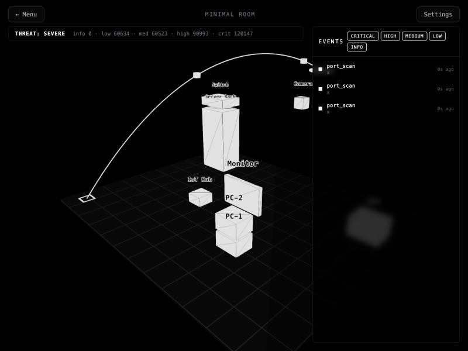
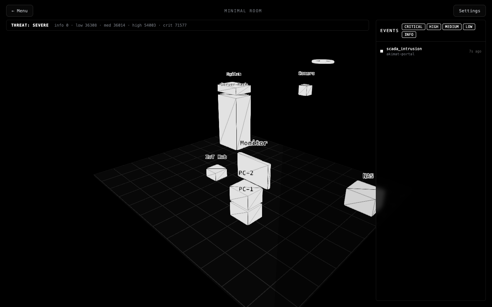
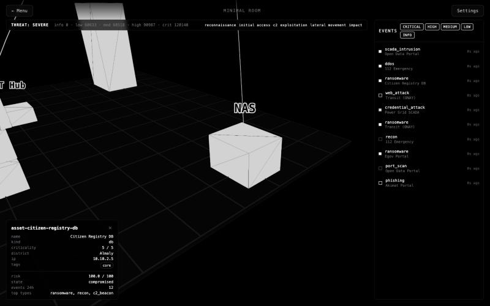
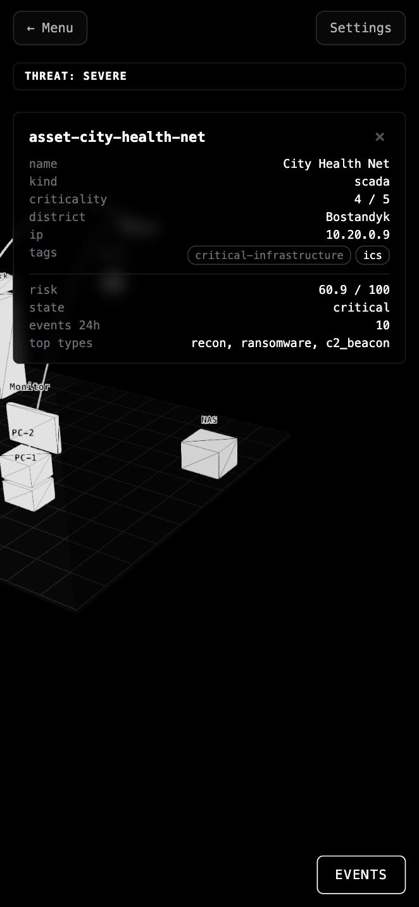

# Key decisions

Each entry states the problem, the options that were on the table, the choice in the code, and
the evidence. Screenshots are reused from `docs/images/ui/`; no new image was captured for this
documentation. Where the repository has no “before” image, the entry says so instead of
reconstructing one.

The three decisions below are the ones required by Sprint 3 task 6. Decisions 2 and 3 live on
open PRs (#48 and #47) at the time of writing; the code references are to those branches.

---

## 1. Monochrome attack arcs

**Status:** shipped with the first room-arc commit `a5ed39d` (“feat(viz): monochrome 3D arcs for
the room space”), still the rule in `viz/roomArcs.ts`.

**Problem.** Five severities (`critical`, `high`, `medium`, `low`, `info`) have to be readable on
a black scene and in a printed thesis. The obvious encoding — one hue per severity — makes the
arcs the only saturated element in a black-and-white instrument and collapses on a grayscale
printer or for readers with colour-vision deficiencies.

**Options considered.**

1. **Hue per severity.** Fast to read on screen, but needs a second print palette, fails in
   grayscale, and spends the only free visual channel on a property that already has a numeric
   label in the HUD.
2. **Monochrome width only.** Print-safe, but a 1 px vs 2.6 px difference is easy to miss on a
   projector and impossible to see when arcs overlap.
3. **Monochrome with redundant channels.** Width, opacity, dash rhythm and packet size all move
   together. Any one of them is enough to rank two arcs; together they survive blur, distance,
   grayscale and colour-vision deficiency.

**Choice.** Option 3. Every arc is `0xffffff` live and `0x15171a` in figure mode; severity changes
only geometry and opacity. The complete table is in
[severity-encoding.md](severity-encoding.md#the-constants). The per-severity `speed` field exists
in the record but is not read by any code, so it is not part of the encoding.

**Evidence.**

- `roomArcs.ts` 39–45: the `STYLES` record.
- `roomArcs.ts` 73: `let arcColor = 0xffffff;`
- `roomArcs.ts` 171–178: `setColor()` recolours in-flight arcs, packets and the unknown marker.
- `room.ts` 501: `arcs.setColor(on ? 0x15171a : 0xffffff)` for print/live.
- `scene.css` 169–173: the HUD dot repeats the same monochrome logic.

**Before.** No “before” screenshot exists in `docs/images/ui/`. The room arcs were monochrome from
their first commit; there was no colour-coded room build whose screenshot could be reused. The
city scene (`docs/images/city-model.png`) is coloured, but it is a different, unmounted scene, not
a before/after of this decision.

**After.** A severity-coded arc in the live look. Width, solid/dashed line, packet size and
opacity are the only differences from another severity; the colour is the same white.



---

## 2. Honest arcs for unmapped destinations (PR #48)

**Status:** implemented on `fix/viz-unmapped-dst`, PR **#48**, open on 2026-11-28. `docs/scene.md`
records the same decision under “Room arcs: unmapped destinations”.

**Problem.** The simulator targets the whole shared inventory, but the room contains only eight
devices. For an event whose `dst.asset_id` was not one of those devices, `destinationPosition()`
hashed the id (or the IP/host) onto a stable device index:

```ts
const idx = Math.abs(hashString(key)) % ids.length;
const chosen = devicePositions.get(ids[idx]);
```

The arc then landed on a device that was **not** attacked. That breaks the project rule that the
UI never invents an asset, and it makes the demo and the thesis figures misleading.

**Options considered.**

1. **Keep the hash fallback.** Every event draws, but the picture is a lie.
2. **Drop unmapped arcs entirely.** Honest, but most of the simulator feed disappears; the room
   looks idle while the HUD counts attacks.
3. **Draw to a neutral marker.** Keep the visual event, end it at a point that is explicitly not
   a device.
4. **Count only, in the HUD.** Honest but hides the spatial story; a counter can be added later
   without closing the door.

**Choice.** Option 3, with option 4 left open. The PR body records the reasoning: because the
backend rejects asset ids outside the inventory, an unmapped destination is a real asset that this
room does not contain; an arc to a marker shows that something outside the layout was hit while
still reading as an attack. Options 2 and 4 would hide most of the demo feed.

**Evidence.**

- `viz/arcEndpoints.ts` 5–7:
  `UNKNOWN_TARGET = new Vector3(-5, 0.15, 4.2)` and
  `EXTERNAL_ORIGIN = new Vector3(0, 5.2, -6.0)`.
- `resolveArc()` at 22–30 returns `{ start, end, unknownTarget }`; an unmapped destination always
  resolves to `UNKNOWN_TARGET.clone()`, never to a device.
- `roomArcs.ts` 75–92: the marker is a `RingGeometry(0.3, 0.4, 4)` — a hollow diamond — rotated
  flat on the floor, `visible = false` until used.
- `roomArcs.ts` 94–96: `if (unknownTarget) markerRemaining = LIFETIME;` (2.6 s).
- `roomArcs.ts` 137–140: the marker fades at `0.85 * min(1, remaining / 0.6)` and is hidden when
  the timer reaches zero.
- `roomArcs.ts` 171–178: the marker follows `setColor()`, so it is white live and `#15171a` in
  figure mode.
- The PR also deleted `hashString()`; nothing else used it.

**Before.** No screenshot of the hashed fallback exists in the repository. It was a logic error,
not a UI state anyone captured. The removed code above is the evidence for the old behaviour.

**After.** The same feed now ends an unmapped arc at the hollow diamond at the lower left instead
of on a device. The arc is still monochrome and still severity-coded.


---

## 3. HUD detail card and event rows use the inventory (PR #47)

**Status:** implemented on `feat/ui-asset-detail`, PR **#47**, open on 2026-11-28. It is the code
that supplies the inventory fields described here.

**Problem.** The detail card showed only the raw id and `RiskState` (`risk`, `state`,
`events 24h`, `top types`). Event rows showed `dst.host`, then `dst.ip`, then `—`. Neither told the
reader what the asset actually was, and the card repeated an opaque id such as
`asset-city-health-net` as its title.

**Options considered.**

1. **Keep id + risk.** No extra request, but the card cannot answer “what is this?”.
2. **Fetch `/api/assets/{id}` every time a device is selected.** Fresh, but a round trip per click,
   and the event list still has no names because rows are not selected.
3. **Fetch the inventory once, index it by id, and relabel rows and the open card.** One request,
   works offline/mock by falling back to host/ip, and can relabel rows already on screen.

**Choice.** Option 3. `openSpace()` calls `fetchInventory().then((inv) =>
hud.setInventory(inv.assets))` once, next to the initial `fetchState()` (`main.ts` 129–131). The
HUD keeps an `AssetIndex`; `setInventory()` relabels every row already rendered and re-renders an
open card (`hud.ts` 245–253). If the request fails or returns nothing, the HUD keeps working with
`—` and host/ip.

**Evidence — field order and fallbacks.**

`assetInfo.ts` 42–55 defines the card order and formatting:

1. `name`
2. `kind`
3. `criticality` as `N / 5`, or `—`
4. `district`
5. `ip`
6. `tags` as chips, or `—`

then a divider and the `RiskState` rows. Missing, `null`, blank and non-finite values become
`MISSING = '—'` (`assetInfo.ts` 4, 9–13). Event rows use
`mapped name → host → ip → —` (`assetInfo.ts` 25–31). The inventory strings are written with
`textContent`, not `innerHTML`; the card title is also `textContent` (`hud.ts` 141–202), which
closes the previous interpolation of the asset id into HTML.

**Before.** The card is absent and the visible row shows the host name `akimat-portal` rather than
a mapped asset name. There is no inventory block.



**After.** Selecting the device opens a card with the inventory block above the risk block. In
this capture: `City Registry DB`, kind `db`, criticality `5 / 5`, district `Almaty`, ip
`10.10.2.5`, tag `core`; below the divider `100.0 / 100`, `compromised`, `249` events in 24 h, top
types `ransomware, recon, c2_beacon`.



The same card at 390 px keeps the inventory fields and the risk block, scrolls inside `46vh`, and
sits above the scene rather than under the event sheet:



**Image caveat.** `desktop-1440-room-asset-detail.png` is **800×500 px**, not 1440×900: it was
captured in a 1440×900 window but saved at 800 px wide (PR #47 notes this). Use the app's figure
export, not this PNG, when a print-resolution figure is needed.

**Not done in #47.** The narration test with one non-team person is still open; the PR says it
needs a human. That is a usability check, not a code gap.
