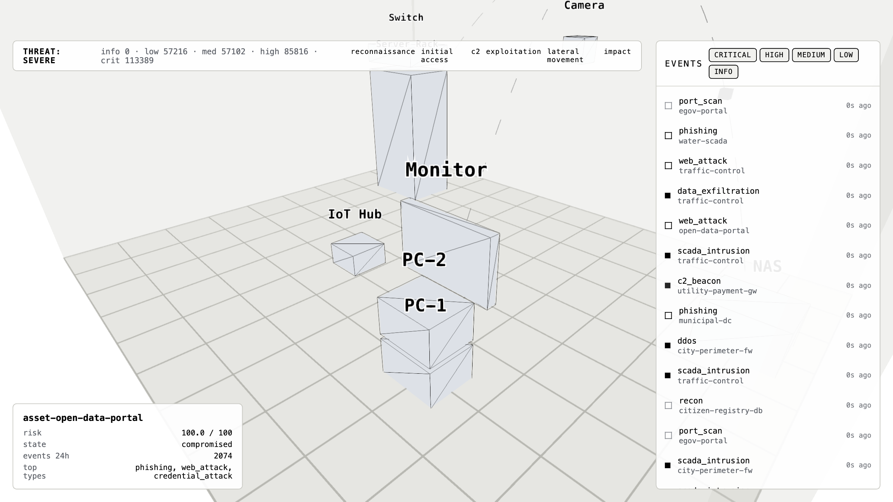

# Thesis figures

How to regenerate every figure of the thesis from the running app. Nothing here needs a
screenshot tool: the app exports the files itself, from Settings → **Figures**. That section is
only rendered while a room is open (`main.ts` passes the figure tools only when `active` is set).



## Before you start

```bash
make reset-db        # otherwise figures show the old 300k-event "severe" demo state
make backend         # terminal 1
make frontend        # terminal 2   →  http://localhost:5173
make simulate        # terminal 3   →  streams the scenario into the backend
```

- Use a desktop window **at least 1280 px wide**. The fixed-size exports lay the HUD out as a
  1280×720 window, but the media queries read the real window, so a narrow one hides parts of it.
- Let the simulator run until the HUD shows the state you want (see the table), then pause it
  (`Ctrl+C`) so the figure and the state file describe the same moment.
- Arcs live 2.6 s (`LIFETIME` in `viz/roomArcs.ts`). To get an arc in the picture, export while the
  simulator is running.

## Exact steps

1. Run the four commands above and open `http://localhost:5173`.
2. Choose **Minimal Room** on the landing page.
3. Click **Settings** in the top bar and turn on **Figure mode**. The panels turn white, the 3D
   scene becomes a light print variant, and the cursor/hover/debug controls are hidden. Turning it
   off restores the live UI exactly.
4. Orbit with the mouse, or click a device to fly to it. The 2400×1350 export keeps the camera
   angle but changes the aspect to 16:9, so frame with that in mind.
5. Let the simulator reach the state for the figure. Pause it with `Ctrl+C` in terminal 3.
6. Open **Settings → Figures** again and press the button for the export you need. The status line
   reports `Saved <file name>`.
7. Press **State JSON** immediately after a PNG so the two files describe the same moment.
8. Check the result: `file threatscope-*.png` must print the stated size; the PNG must not be
   black; the SVG must open in a browser and Inkscape.

The export buttons, in the order the modal builds them (`ui/settings.ts` 52–61):

| Button | File | Content |
|---|---|---|
| **Scene PNG · window** | `…-scene-<stamp>.png` | 3D view only, at window size × device pixel ratio (capped at 2) |
| **Scene PNG · 2400×1350** | `…-scene-2400x1350-<stamp>.png` | 3D view only, 16:9, pixel ratio 1 |
| **Scene + HUD PNG · window** | `…-scene-hud-<stamp>.png` | scene with the HUD panels painted on top, window size |
| **Scene + HUD PNG · 2400×1350** | `…-scene-hud-2400x1350-<stamp>.png` | same, HUD laid out for 1280×720 and scaled 1.875× |
| **Timeline SVG** | `…-timeline-<stamp>.svg` | vector timeline; **only shown once `getTimelineSvg` exists** |
| **State JSON** | `…-state-<stamp>.json` | `/api/state`, selected asset's `RiskState`, camera, settings, replay position |

File name: `threatscope-<space>-<view>-<YYYYMMDD-HHmm>.<ext>` (local time; `<space>` is the space
id, e.g. `room`). The view is `scene`, `scene-hud`, `scene-2400x1350` or
`scene-hud-2400x1350`; the state and timeline suffixes are `state` and `timeline`
(`ui/figures.ts` 45–50, 162–171).

## Figure mode and print look

Figure mode is two switches at once:

1. `document.body.classList.add('figure-mode')` — the CSS in `styles/scene.css` turns the HUD
   panels into `rgba(255, 255, 255, 0.92)` with `#15171a` text and hides the feed control, the
   events toggle and the detail-card close button.
2. `scene.setFigureMode(true)` — `room.ts` swaps the WebGL background to `0xffffff`, every themed
   material to its light value, the arcs and packets to `0x15171a`, and tone mapping from
   `ACESFilmicToneMapping` to `NoToneMapping` so the white page stays white. Hover highlights and
   the pointer cursor are suppressed.

`captureFrame()` renders one frame at pixel ratio 1, copies it into a 2D canvas **in the same
task** (the renderer has no `preserveDrawingBuffer`), then restores the live size, camera aspect
and render. The HUD is painted from the live DOM by `ui/domPainter.ts`; it supports backgrounds,
borders, clipping, opacity and per-character text, but **not** shadows, gradients, images or
backdrop blur. If the HUD starts using those, extend the painter or the exports silently omit
them.

## The figure set

Camera: orbit with the mouse, or click a device to fly to it. The pose is saved in the state file
(`camera.position`, `camera.target`, `camera.fov`), so a figure can be re-framed later.

| # | Figure | Space | Scenario / state | Selection | Replay position | Export |
|---|---|---|---|---|---|---|
| 1 | The 3D room, no UI | Minimal room | any, simulator paused | none | — | Scene PNG · 2400×1350, figure mode on |
| 2 | Room with live arcs | Minimal room | simulator at 2 threats/s | none | — | Scene PNG · 2400×1350, figure mode on, export while arcs are visible |
| 3 | Full product screen | Minimal room | simulator ran ≥ 1 min | none | — | Scene + HUD PNG · 2400×1350, figure mode on |
| 4 | Asset drill-down | Minimal room | as figure 3 | click `asset-open-data-portal` in the event list | — | Scene + HUD PNG · 2400×1350, figure mode on (detail card shows the risk) |
| 5 | Same figure, dark UI | Minimal room | as figure 3 | none | — | Scene + HUD PNG · 2400×1350, figure mode **off** |
| 6 | Timeline | Minimal room | recorded scenario | — | full window | Timeline SVG — *pending the timeline panel (`feat/ui-timeline`)* |
| — | Reproduction data | any | any | the asset shown | — (replay controls pending) | State JSON, next to every figure above |

The replay position and the timeline depend on the sprint-3 replay controls and the drill-down
timeline. Until they merge, the state file records `"replay": null` and the Timeline SVG button is
not shown. When they land, wire them in `main.ts` through `getReplay` and `getTimelineSvg` of
`createFigureTools` (`ui/figures.ts`); the export code does not change.

## Checking a figure

- **PNG size:** `file threatscope-*.png` must print exactly the stated size. A 2400×1350 export
  must be 2400×1350, not the window size.
- **Not black:** the scene is copied out of the WebGL buffer in the same task as the render; an
  all-black PNG means that copy broke.
- **HUD contents:** in figure mode the feed control, events toggle and close button are gone, and
  the panels are light. If they are dark, the `body.figure-mode` class was lost.
- **SVG:** opens in a browser and in Inkscape. Text keeps `SF Mono`; convert text to outlines
  before sending to print if the font is not installed.
- **State file:** the JSON schema is `threatscope.figure-state/1`; it records `figure_mode`,
  `viewport`, `settings`, `camera`, `api_state`, `selected_asset`, `replay` and `errors`.

Do **not** use `docs/images/ui/desktop-1440-room-asset-detail.png` as a print figure: despite its
name it is 800×500 px. It is a UI decision screenshot, not a 2400×1350 export.

## Current limits (checked in code)

- **Bloom is recorded but not rendered in the room.** `room.ts` creates the room's render context
  with `bloom: false`; the Settings toggle is persisted and written into the state file, but it
  does not change the room image. The legacy city scene is the only consumer of the setting.
- **Two live-feed subscriptions.** The room handler and the module-level
  `window.__threatscopeLive` handler both call `spawnArc`; each opens its own socket. As written,
  the same event is drawn twice while a room is open. This affects “room with live arcs” figures:
  expect doubled arcs until the frontend is fixed. Not observed in a browser for this
  documentation; see [severity-encoding.md](severity-encoding.md#edge-cases-checked-in-code).
- **No automated figure check.** The checks above are manual. The repository has no visual
  regression runner and CI runs `typecheck` and `build`, not exports.
- **The print HUD is a 1280×720 layout.** The 2400×1350 export scales it 1.875×; it is not a
  responsive 2400 px layout. Very long values are ellipsised by the painter as they are on screen.

## How it works (for maintainers)

- `scene.captureFrame(w, h)` (`scene/room.ts`) renders one frame at pixel ratio 1, copies it into
  a 2D canvas, then restores the live size and camera aspect. `preserveDrawingBuffer` stays off.
- `ui/domPainter.ts` paints the HUD onto that canvas from the live DOM (backgrounds, borders,
  clipping, per-character text).
- `ui/figures.ts` owns file names, downloads, the SVG serializer (inlines styles) and the state
  file.
- Figure mode = `body.figure-mode` (CSS in `styles/scene.css`) + `scene.setFigureMode()`.
