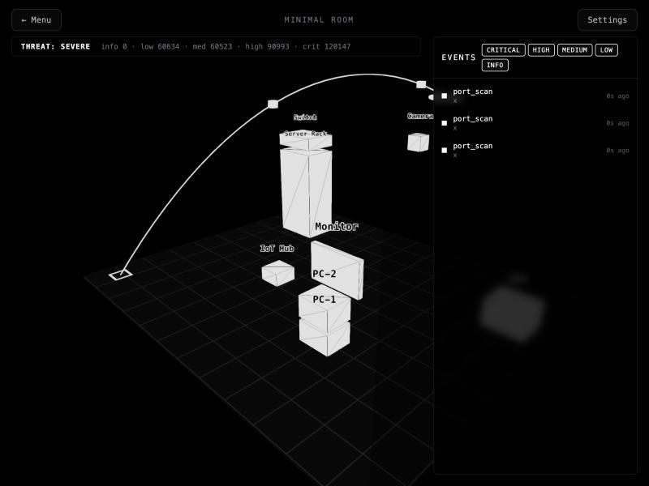

# Severity encoding

Severity is never carried by hue. The attack arcs, their packets and the event-list dots are
grayscale; a higher severity is a **thicker, more opaque, more solid, faster-looking** arc with a
**larger packet**. This page quotes the constants from `frontend/src/viz/roomArcs.ts` and the
mirrored HUD encoding in `frontend/src/styles/scene.css`.



## Where the encoding lives

The mounted room uses `createRoomArcsLayer()` (`viz/roomArcs.ts`), called once from
`scene/room.ts`. The older `viz/arcs.ts` layer belongs to `city.legacy.ts` and is not mounted:
`main.ts` registers only the `room` factory. Only `roomArcs.ts` values are documented here.

An event becomes an arc when a live `event` frame reaches `scene.spawnArc()`. There are **two
feed subscriptions in `main.ts`**: the room-level one inside `openSpace()` calls `spawnArc` only
when `ev.dst.asset_id` is truthy (`main.ts` 134–143), and the module-level one used for
`window.__threatscopeLive` calls it for every event frame (`main.ts` 229–243). `connectFeed()`
opens a separate socket per call and does not deduplicate (`data/socket.ts` 44–107). While a room
is open, both handlers are live, so in the code as written an event normally reaches `spawnArc`
twice, and an event with a `null` destination id still produces an arc through the second handler.
This duplication is a frontend defect, not a design rule; it was found by reading the code and was
not observed in a running browser for this documentation. Endpoint resolution then decides which
two points each arc connects; if the destination id is not a device in this room, the arc ends at
`UNKNOWN_TARGET` rather than a guessed device (see [decisions.md](decisions.md), decision 2).

## The constants

`STYLES` is a `Record<Severity, ArcStyle>`; this is the complete table, copied verbatim from
`roomArcs.ts` 39–45:

```ts
const STYLES: Record<Severity, ArcStyle> = {
  critical: { width: 2.6, opacity: 0.95, dashed: false, dashSize: 0, gapSize: 0, packetSize: 0.22, speed: 1.0 },
  high: { width: 2.0, opacity: 0.82, dashed: false, dashSize: 0, gapSize: 0, packetSize: 0.18, speed: 0.9 },
  medium: { width: 1.6, opacity: 0.68, dashed: true, dashSize: 0.4, gapSize: 0.3, packetSize: 0.16, speed: 0.8 },
  low: { width: 1.2, opacity: 0.5, dashed: true, dashSize: 0.25, gapSize: 0.45, packetSize: 0.14, speed: 0.7 },
  info: { width: 1.0, opacity: 0.32, dashed: true, dashSize: 0.15, gapSize: 0.55, packetSize: 0.12, speed: 0.6 },
};
```

| Severity | Width | Base opacity | Line | Dash / gap | Packet side | Speed field |
|---|---:|---:|---|---|---:|---:|
| `critical` | 2.6 | 0.95 | solid | 0 / 0 | 0.22 | 1.0 |
| `high` | 2.0 | 0.82 | solid | 0 / 0 | 0.18 | 0.9 |
| `medium` | 1.6 | 0.68 | dashed | 0.4 / 0.3 | 0.16 | 0.8 |
| `low` | 1.2 | 0.5 | dashed | 0.25 / 0.45 | 0.14 | 0.7 |
| `info` | 1.0 | 0.32 | dashed | 0.15 / 0.55 | 0.12 | 0.6 |

**`speed` is not used.** The field is declared in `ArcStyle` and set on every row, but no code
reads `style.speed`. Packets all advance at `curve.getPoint(progress / 0.85)`, so every severity
takes the same time to cross the same curve. The perceptual difference in motion comes from the
packet size and the arc's fade, not from speed. Do not cite speed as a severity channel.

## How each channel is applied

- **Width** — `style.width` is passed to `LineMaterial.linewidth` (`roomArcs.ts` 111–120). It is
  a line width, not a world-space tube, so it does not scale with camera distance.
  Critical is 2.6× the info width.
- **Opacity** — the material starts at `opacity: 0` and is set every frame to `style.opacity`
  multiplied by a fade envelope. Critical is 0.95, info 0.32.
- **Dash** — `dashed`, `dashSize` and `gapSize` go straight into `LineMaterial`. Critical and high
  are solid. Medium has a dash longer than its gap; low and info have a gap longer than the dash,
  so the line reads progressively more broken as severity drops.
- **Packet size** — a `BoxGeometry(style.packetSize, style.packetSize, style.packetSize)` cube
  travels along the curve (`roomArcs.ts` 127–132). Its side goes from 0.12 (`info`) to 0.22
  (`critical`) world units. There is no per-severity packet geometry cache; each spawn creates and
  disposes one box.
- **Colour** — one colour for every arc: `let arcColor = 0xffffff` (`roomArcs.ts` 73). Turning
  figure mode off calls `arcs.setColor(0xffffff)`; turning it on calls
  `arcs.setColor(0x15171a)` (`room.ts` 501). `setColor` recolours in-flight arcs, their packets
  and the unknown-target marker (`roomArcs.ts` 171–178).

## Time envelope

All arcs use `const LIFETIME = 2.6;` seconds (`roomArcs.ts` 47) and a quadratic Bézier curve with
28 samples. The control point is lifted by `distance * 0.35 + 1.2` above the midpoint
(`roomArcs.ts` 99–104), so long arcs bow higher.

Within those 2.6 s (`roomArcs.ts` 137–164):

| Progress | What happens |
|---|---|
| `0 → 0.10` | Opacity ramps from 0 to the severity's base opacity (0.26 s). |
| `0.10 → 0.70` | Full base opacity. |
| `0.70 → 1.00` | Opacity falls linearly to 0 (0.78 s). |
| `0 → 0.85` | Packet travels the curve; at 0.85 it reaches the endpoint and is hidden. |
| `1.00` | Line, geometry, material and packet are removed and disposed. |

The packet is therefore visible for 2.21 s and invisible for the final 0.39 s while the line fades.

## The HUD repeats the encoding

The event list has an 8×8 px dot per row. It uses fill / outline instead of width and opacity
(`scene.css` 169–173):

| Severity | Live | Figure mode |
|---|---|---|
| `critical` | filled `#ffffff` | filled `#000000` |
| `high` | filled `#ffffff`, `opacity: 0.85` | filled `#000000` |
| `medium` | hollow: `1px solid #ffffff` | hollow: `1px solid #000000` |
| `low` | hollow: `1px solid #555555` | hollow: `1px solid #8a8d93` |
| `info` | filled `#333333` | filled `#c4c4be` |

The five filter chips (`critical`, `high`, `medium`, `low`, `info`) are all active on load. They
filter rows by the event's `severity` string and do not change the arcs.

## Edge cases checked in code

- **Unknown severity on an arc** falls back to the `info` row: `STYLES[event.severity] ??
  STYLES.info` (`roomArcs.ts` 97). It renders, with info geometry, instead of throwing.
- **Unknown severity in the list** gets `class="hud-event hud-sev-<value>"`. No rule matches that
  class, so the base white 8×8 square applies; on insert it is also `hidden` because it is not in
  `activeFilters`, which contains only the five known values (`hud.ts` 83, 213–218). It does not
  throw, but it is not visible. This path is not exercised by the simulator.
- **Several events at once** produce separate overlapping arcs. There is no aggregation, count
  badge or per-asset severity state on the arc; each `spawnArc` call is one line (with the double
  feed subscription above, one event normally produces two). The `RiskState` number lives only in
  the detail card.
- **No severity legend is drawn in the scene.** The only legend is the event-list dot plus the
  filter chips; the width/dash/packet mapping is learned from the events themselves.

## Why monochrome

The code shows *that* the arcs are monochrome, not *why*. The rationale below is the design
argument for the choice recorded in [decisions.md](decisions.md); it is not a code comment:

1. **The product is a black-and-white instrument.** The room is white geometry on black, and the
   only routed UI colour is error red. A five-hue severity ramp would be the only saturated thing
   on screen and would compete with the geometry.
2. **The thesis is printed.** Figure mode produces a white page with `#15171a` arcs. A hue ramp
   would have to be re-mapped for print anyway; width, opacity, dash and packet size survive a
   grayscale printer and a photocopy unchanged.
3. **Four channels are redundant.** Severity is readable if any one of width, fill, dash rhythm or
   packet size is visible. A single hue channel fails for colour-vision deficiencies and for
   readers who cannot distinguish dark red from dark orange on a dark background.
4. **It keeps one visual variable free.** Colour is not spent on severity, so the same white can
   later mark selection, hover, or an alert level without colliding with an existing severity
   colour.
