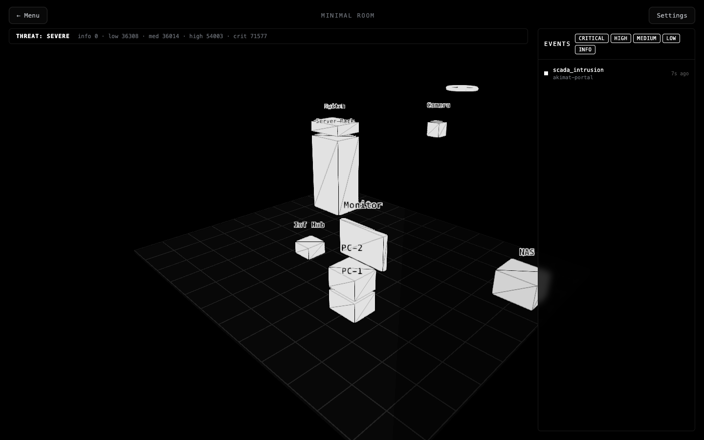
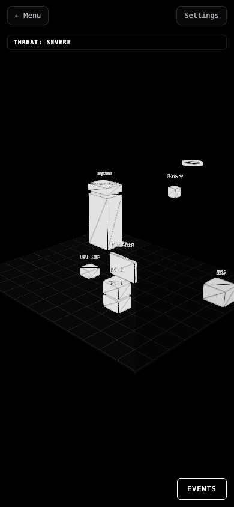
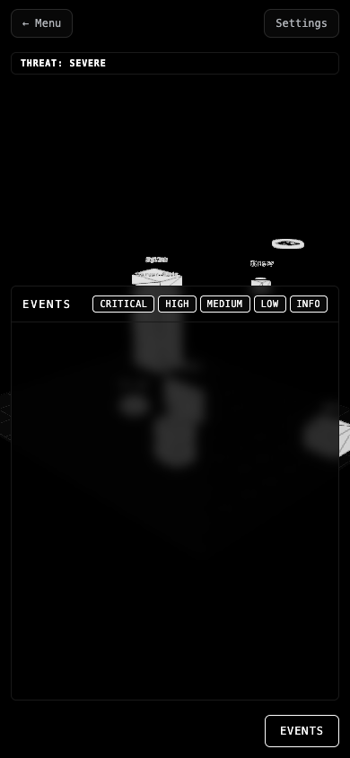
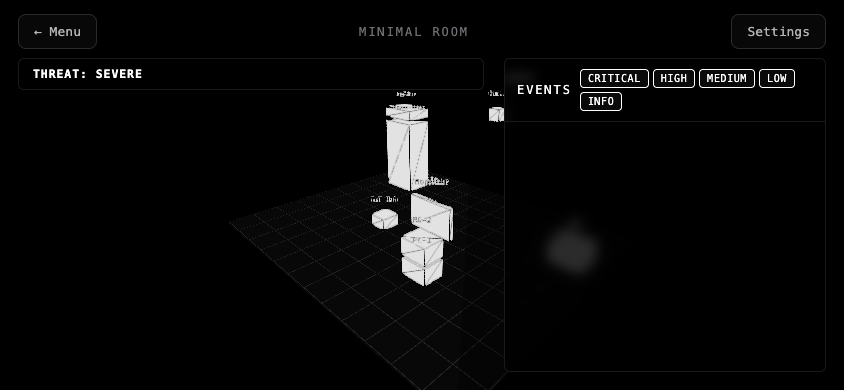

# Typography and layout

All type is system monospace. There is no `@font-face`, no webfont request and no font token
layer; the stacks are repeated in `frontend/src/styles/scene.css` and `menu.css`. Sizes are CSS
pixels as written in those files.

## Font stacks

| Surface | Stack | Where |
|---|---|---|
| HUD (banner, panel, detail, toggle, feed control, room label) | `'SF Mono', Consolas, Menlo, monospace` | `scene.css` 42, 84, 213, 310, 398, 422 |
| Landing / menu | `'SF Mono', Consolas, 'JetBrains Mono', Menlo, monospace` | `menu.css` 10 |
| Top bar, settings modal | `'SF Mono', Consolas, Menlo, monospace` | `menu.css` 230, 283 |
| 3D device labels | `bold 76px "SF Mono", Consolas, monospace` painted into a 1024×192 canvas texture, then drawn as a sprite scaled 3.2×0.6 | `textures.ts` 30–43; `room.ts` 319 |

The menu stack is the only one that lists JetBrains Mono; it is a fallback, not a bundled font.
On macOS the first family (SF Mono) is expected; on Windows/Linux the render falls to Consolas,
Menlo or the generic monospace.

## Type scale

| Element | Selector | Size | Weight / tracking / case |
|---|---|---|---|
| Banner body | `.hud-banner` | 11.5 px (10 px ≤ 768) | normal |
| Threat level | `.hud-banner-level` | inherits 11.5 px | 700, `0.08em`, uppercase |
| Severity counts | `.hud-banner-counts` | inherits 11.5 px | normal, muted `#6b6f76` |
| Kill-chain chips | `.hud-kill` | 10 px (9 px ≤ 768) | `0.06em`, lowercase stage names |
| Panel title | `.hud-panel-title` | 12 px | `0.16em`, uppercase |
| Severity filters | `.hud-filter` | 10 px | `0.06em`, uppercase |
| Event type | `.hud-event-type` | 11.5 px | normal |
| Event target | `.hud-event-asset` | 10.5 px | normal, single line with ellipsis |
| Event time | `.hud-event-time` | 10 px | normal |
| Detail title | `.hud-detail-head strong` | 13 px | bold |
| Detail rows | `.hud-detail-row` | 11 px | normal |
| Tag chips | `.hud-tag` | 10 px / 16 px line-height | normal |
| Events toggle (phone) | `.hud-toggle` | 12 px | `0.08em`, uppercase |
| 3D label | canvas texture | 76 px in a 1024×192 texture | bold, white 10 px outline |
| Room label | `.room-label` | 11 px | `0.06em` |
| Feed control | `.feed-control` | 10 px | `0.08em`; label and unit uppercase |
| Feed buttons | `.feed-control button` | 10 px | normal |
| Top-bar button | `.topbar-btn` | 13 px (12 px ≤ 560) | normal |
| Top-bar title | `.topbar-title` | 12 px (10 px ≤ 560) | `0.16em`, uppercase |
| Wordmark | `.menu-wordmark` | `clamp(44px, 7vw, 88px)`; `clamp(30px, 9.5vw, 56px)` ≤ 900 | 700, `-0.02em` (`-0.03em` ≤ 900), line-height 1 |
| Menu status | `.menu-status` | 12 px | `0.06em` |
| Menu buttons | `.menu-new`, `.menu-settings-bottom` | 13 px | normal |
| Menu rows | `.menu-row` | 15 px | normal |
| Notice | `.menu-notice` | 13 px | normal |
| Modal title | `.modal-head h2` | 16 px | normal |
| Modal note | `.modal-note` | 12 px / 1.55 | normal |
| Settings row title | `.modal-row-text strong` | 13 px | normal |
| Settings row detail | `.modal-row-text span` | 11.5 px / 1.45 | normal |
| Section heading | `.modal-section h3` | 11 px | 600, `0.16em`, uppercase |
| Export button | `.export-btn` | 11.5 px | normal |
| Export status | `.export-status` | 11 px / 1.4 | normal |
| Modal footer | `.modal-foot` | 11 px | normal |
| Field label | `.field-label` | 11 px | `0.18em`, uppercase |
| Field input | `.field-input` | 15 px | normal |
| Option title / hint | `.option b` / `.option small` | 14 px / 12 px | 500 / normal |
| Dialog buttons | `.btn-ghost`, `.btn-solid` | 13 px | normal |
| Builder count | `.builder-count` | 11 px | `0.14em`, uppercase |
| Builder cell | `.cell` | 9 px | `0.06em` |

The 9–11 px range is deliberate instrument chrome, not body copy. If the thesis quotes this UI at
page size, quote the 2400×1350 figure exports rather than the 11 px screen typography.

## HUD composition

The canvas and HUD are fixed, full-viewport layers (`#scene`, `#hud`); the top bar and menu sit
above them.

| Layer | Element | Position / size | z-index |
|---|---|---|---|
| 3D canvas | `#scene` | `inset: 0`, 100 % × 100 % | auto |
| HUD root | `#hud` | `inset: 0`, `pointer-events: none` | auto |
| Threat banner | `.hud-banner` | `top: 58px; left: 18px; right: 360px`; padding 8×14; radius 6 | 15 |
| Event panel | `.hud-panel` | `top: 58px; right: 18px; bottom: 18px; width: 320px` | 15 |
| Detail card | `.hud-detail` | `bottom: 18px; left: 18px; width: 300px`; padding 12×14; radius 6 | 15 |
| Mobile toggle | `.hud-toggle` | `bottom: 18px; right: 18px`; hidden above 768 | 16 |
| Demo feed control | `.feed-control` | `top: 100px`, horizontally centred | 16 |
| Top bar | `#topbar` | `top: 0; left/right: 0`; padding 14×18 | 20 |
| Landing | `#menu` | `inset: 0` | 20 |
| Settings backdrop | `.modal-backdrop` | `inset: 0` | 40 |

`#hud` ignores pointer events; the panel, detail card and toggle re-enable them. The banner stays
click-through.

### Desktop 1440×900

At 1440 px the event panel occupies x = 1102…1422 (320 px wide, 18 px from the right). The banner
ends at x = 1080, leaving a 22 px gap before the panel. The detail card, when open, occupies
x = 18…318 at the bottom left. The threat banner shows the level, the five counts and the six
kill-chain stages; the kills are dropped below 1100 px and the counts below 900 px.

The screenshot is the live (dark) look. It is a 1440×900 PNG and predates the kill-chain chips
(they landed in #31, after this capture); the current live banner also renders them at this
width.

### Phone 390×844

Below 768 px the right panel stops being a side panel and becomes a bottom sheet:

- position: `left: 12px; right: 12px; bottom: 64px; width: auto`
- height: `min(58vh, 460px)` (460 px at 844 px viewport height)
- hidden by `transform: translateY(calc(100% + 96px))`; adding `.open` slides it to `translateY(0)`
  over 0.24 s
- the `Events` toggle appears at `bottom: 12px; right: 12px`

The detail card moves to `top: 104px; left: 12px; right: 12px; width: auto; max-height: 46vh;
overflow-y: auto`, so it sits above the scene and never under the open sheet. The banner keeps
only the threat level at this width: the counts are hidden below 900 px and the kill-chain chips
below 1100 px. The top-bar title is hidden at 430 px and below; the two buttons remain.

### Phone landscape 844×390

At 844×390 the viewport is wider than 768 px, so the 320 px side panel is used again, but the
counts (≤ 900) and kill chips (≤ 1100) are gone. This is the capture where the side panel and the
844 px-wide banner are tightest.

## Breakpoints

These are **all** the media queries in the two stylesheets. There is no `1440` and no `390` query:
those numbers are the capture widths of the screenshots, not breakpoints.

| Query | File | Effect |
|---|---|---|
| `max-width: 1100px` | `scene.css` | Hide `.hud-banner-kill`; keep counts on one line. |
| `max-width: 900px` | `scene.css` | Hide `.hud-banner-counts`; keep the level on one line. |
| `max-width: 768px` | `scene.css` | Banner inset 12 px, 10 px type, 6×10 padding; hide counts; kill gap 4 px and 9 px type; event panel becomes the bottom sheet; show `.hud-toggle`; detail card to `top: 104px`; feed control to `top: 96px`. |
| `max-width: 900px` | `menu.css` | Landing becomes one column; brand border moves to the bottom; wordmark shrinks; side padding 20×24; settings button at 18 px. |
| `max-width: 620px` | `menu.css` | Space builder becomes one column; palette wraps to rows at 46 % width. |
| `max-width: 560px` | `menu.css` | Top bar padding 10×12; buttons 8×12 at 12 px; title 10 px with `0.1em`. |
| `max-width: 430px` | `menu.css` | Hide `.topbar-title`. |

## Shape and spacing tokens (as written)

There is no spacing scale. The recurring values are:

- **Radii:** 4 px (filter chips, feed buttons), 6 px (banner, panel, detail, menu-new,
  settings-bottom, export button), 8 px (top-bar buttons, modal rows, field input, option rows,
  dialog buttons), 10 px (modal, builder grid), 999 px (switch track).
- **Borders:** 1 px everywhere; HUD dividers are a 1 px `#1a1a1a` element.
- **HUD padding:** banner 8×14; panel head 10×12; panel list 6×0; detail 12×14; event row 8×12.
- **Panel width:** 320 px side panel, 300 px detail card, 360 px reserved on the banner's right
  (320 + 18 + 22 gap).

## What is not there

- No focus-visible styles: buttons rely on the browser default. The HUD is not a keyboard-first
  surface; the event rows are buttons but the detail card is opened by pointer events.
- No responsive type scale beyond the wordmark and the 768 px HUD / 560 px top-bar steps.
- No reduced-motion query. Sheet transition (0.24 s), fade transitions (0.12–0.2 s) and the focus
  camera animation (0.7 s) always run.
- No dark/light theme system. “Live” and “figure mode” are the two looks, and figure mode is a
  class plus a scene call, not a CSS theme.
