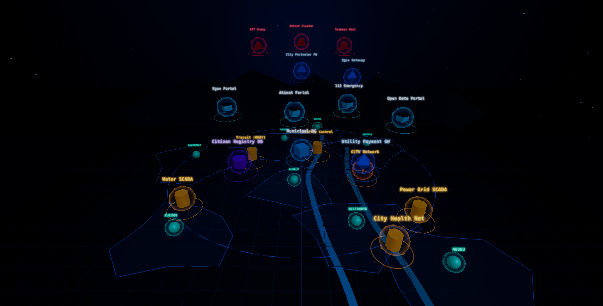

# The 3D city scene

`frontend/src/scene` renders the Almaty city model: the ground, the eight districts, the two
rivers, the ring road, the Trans-Ili Alatau ridge on the horizon, and one mesh per asset.



## Data flow

```
data/assets.json  →  frontend/src/main.ts  →  parseInventory()  →  createCityScene()
```

The scene never fetches anything. `main.ts` imports the shared inventory file, hands it to
`parseInventory()` (which validates it and degrades unknown values instead of throwing), and
passes the result to `createCityScene()`. Everything below `scene/` works on the parsed
`Asset[]` / `Link[]` only.

Asset positions come from `position` in `data/assets.json` — the scene never hardcodes a
coordinate for an asset. The city furniture (ground plate, rivers, ring road, ridge) is
decoration and lives in `scene/`.

## Modules

| Module | Responsibility |
|---|---|
| `index.ts` | assembles the scene, owns the render loop, resize handling, picking and stats |
| `renderer.ts` | WebGL renderer, post-processing chain (bloom → FXAA → output), sizing |
| `camera.ts` | perspective camera, orbit controls with damping, zoom limits, reset |
| `lights.ts` | ambient + key + fill + rim light rig |
| `environment.ts` | sky gradient environment map, exponential fog, starfield, horizon haze |
| `ground.ts` | ground plate with a canvas texture, grid, distant apron |
| `districts.ts` | district pads and outlines, placed from the `district` assets |
| `rivers.ts` | two river ribbons generated along a Catmull-Rom curve |
| `ringRoad.ts` | dashed ring road around the city |
| `ridge.ts` | Trans-Ili Alatau ridge, two merged peak rows on the horizon |
| `assetMeshes.ts` | mesh, glow, halo, shield shell and label per asset |
| `palette.ts` | colour, emissive and roughness per asset kind |
| `labels.ts` | cached canvas-texture sprite labels |
| `textures.ts` | canvas texture factories (glow, label, ground) |
| `shaders.ts` | fresnel shield shader |
| `inventory.ts` | validation of the raw inventory into `Asset[]` / `Link[]` |
| `types.ts` | public types of the scene API |

## Asset kinds

`kind` selects the mesh. Unknown kinds fall back to `service` instead of throwing.

| kind | mesh | colour |
|---|---|---|
| `scada` | cylinder (industrial tank) | amber |
| `server` | box (rack) | blue |
| `gateway` | octahedron | blue |
| `district` | sphere | teal |
| `db` | drum | violet |
| `service` | box with a canopy | light blue |
| `cctv` | mast with a camera head | orange |
| `external` | tetrahedron | red |

## API

```ts
const scene = createCityScene(canvas, { assets, links, bloom, labels, pixelRatio });

scene.start();
scene.getStats();      // { fps, frameMs, drawCalls, triangles, assets, labelCount }
scene.pick(x, y);      // asset id under the pointer, or null
scene.focusAsset(id);  // camera flies to an asset
scene.resetView();     // back to the default framing
scene.resize();        // re-reads the canvas size
scene.dispose();
```

## Performance

Measured in Chrome 157 on an Apple M4 GPU, 1600×813, production build, all 26 assets:

| metric | value |
|---|---|
| fps | 60.0 (16.7 ms per frame) |
| draw calls | 188 |
| triangles | 29 933 |

The frame budget is kept flat by sharing one geometry per asset kind, capping the pixel ratio
at 1.75, keeping the bloom pass at a fixed 512×512 resolution, and avoiding per-frame
allocations in the update loop.

## Next

Link conduits, attack arcs and event-driven risk states belong to `frontend/src/viz` and
consume `RiskState` once the backend exposes it.
