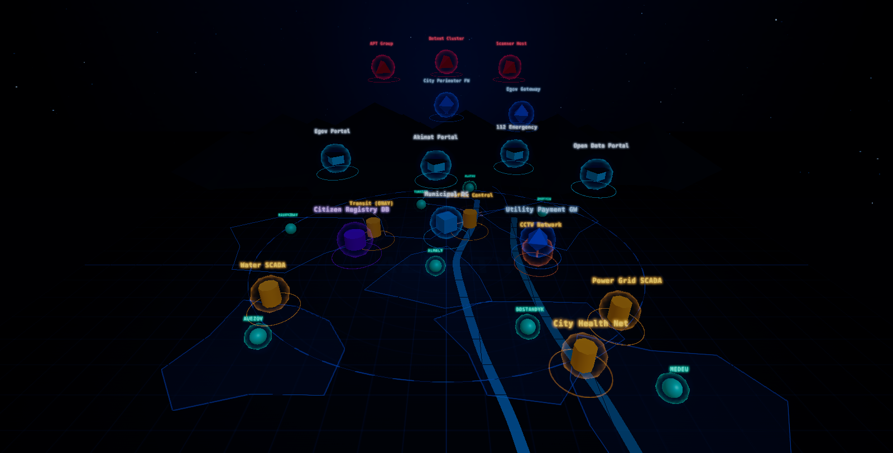
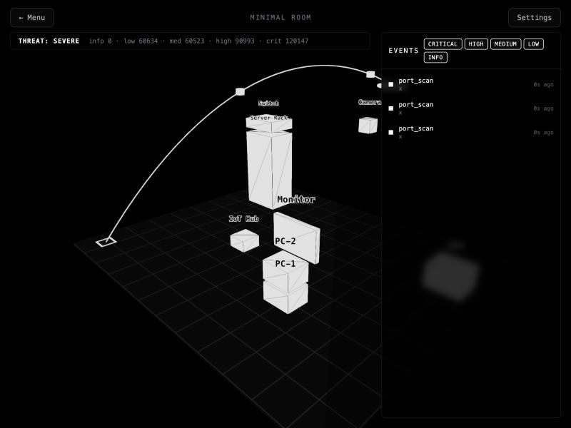

# The 3D city scene

`frontend/src/scene` renders the Almaty city model: the ground, the eight districts, the two
rivers, the ring road, the Trans-Ili Alatau ridge on the horizon, and one mesh per asset.



## Data flow

```
data/assets.json  →  frontend/src/main.ts  →  parseInventory()  →  createCityScene()
```

The scene never fetches anything. `main.ts` imports the shared inventory file, hands it to
`parseInventory()` (which validates it and degrades unknown values instead of throwing), and
passes the result to `createCityScene()`. Everything below `scene/` works on the parsed
`Asset[]` / `Link[]` only.

Asset positions come from `position` in `data/assets.json` — the scene never hardcodes a
coordinate for an asset. The city furniture (ground plate, rivers, ring road, ridge) is
decoration and lives in `scene/`.

## Modules

| Module | Responsibility |
|---|---|
| `index.ts` | assembles the scene, owns the render loop, resize handling, picking and stats |
| `renderer.ts` | WebGL renderer, post-processing chain (bloom → FXAA → output), sizing |
| `camera.ts` | perspective camera, orbit controls with damping, zoom limits, reset |
| `lights.ts` | ambient + key + fill + rim light rig |
| `environment.ts` | sky gradient environment map, exponential fog, starfield, horizon haze |
| `ground.ts` | ground plate with a canvas texture, grid, distant apron |
| `districts.ts` | district pads and outlines, placed from the `district` assets |
| `rivers.ts` | two river ribbons generated along a Catmull-Rom curve |
| `ringRoad.ts` | dashed ring road around the city |
| `ridge.ts` | Trans-Ili Alatau ridge, two merged peak rows on the horizon |
| `assetMeshes.ts` | mesh, glow, halo, shield shell and label per asset |
| `palette.ts` | colour, emissive and roughness per asset kind |
| `labels.ts` | cached canvas-texture sprite labels |
| `textures.ts` | canvas texture factories (glow, label, ground) |
| `shaders.ts` | fresnel shield shader |
| `inventory.ts` | validation of the raw inventory into `Asset[]` / `Link[]` |
| `types.ts` | public types of the scene API |

## Asset kinds

`kind` selects the mesh. Unknown kinds fall back to `service` instead of throwing.

| kind | mesh | colour |
|---|---|---|
| `scada` | cylinder (industrial tank) | amber |
| `server` | box (rack) | blue |
| `gateway` | octahedron | blue |
| `district` | sphere | teal |
| `db` | drum | violet |
| `service` | box with a canopy | light blue |
| `cctv` | mast with a camera head | orange |
| `external` | tetrahedron | red |

## API

```ts
const scene = createCityScene(canvas, { assets, links, bloom, labels, pixelRatio });

scene.start();
scene.getStats();      // { fps, frameMs, drawCalls, triangles, assets, labelCount }
scene.pick(x, y);      // asset id under the pointer, or null
scene.focusAsset(id);  // camera flies to an asset
scene.resetView();     // back to the default framing
scene.resize();        // re-reads the canvas size
scene.dispose();
```

Figure export (room scene, see [design/figures.md](design/figures.md)):

```ts
scene.captureFrame(2400, 1350);  // 2D canvas, rendered at pixel ratio 1; live view restored
scene.setFigureMode(true);       // light print variant, no hover highlight, no cursor
scene.getCameraPose();           // { position, target, fov } for the state file
```

## Performance

Measured in Chrome 157 on an Apple M4 GPU, 1600×813, production build, all 26 assets:

| metric | value |
|---|---|
| fps | 60.0 (16.7 ms per frame) |
| draw calls | 188 |
| triangles | 29 933 |

The frame budget is kept flat by sharing one geometry per asset kind, capping the pixel ratio
at 1.75, keeping the bloom pass at a fixed 512×512 resolution, and avoiding per-frame
allocations in the update loop.

### Room under load

Measured in the embedded Chromium 156 pane of the Claude desktop app on an Apple M4 GPU
(ANGLE Metal), 1024×768 at device pixel ratio 2, production build (`vite build`, served with
`vite preview`), the built-in room with 8 devices, local backend, `scene.getStats()` sampled every
2.5 s. Load was `python3 simulator/simulate.py` at the rates below; the simulator targets
inventory assets, most of which are not devices in the room, so the unknown-target marker was in
constant use.

| load | fps | ms per frame | draw calls | triangles |
|---|---|---|---|---|
| idle, no events | 36 | 27.8 | 56 | 974 |
| `make simulate` (`--rate 2`) | 31 (31.0–34.6) | 28.9–32.2 | 64–98 | 1 694–4 590 |
| `--rate 10` | 31 (31.0–31.6) | 31.7–32.2 | 72–76 | 2 406–2 766 |

These are **not comparable with the 60 fps city figure above**. In this pane the idle room already
runs at 36 fps and an unrelated page's `requestAnimationFrame` loop ran at 31–36 fps while the
scene was open, so the frame pacing is capped by the pane and `frameMs` is wall-clock time between
frames, not render cost. What the table does show is that arcs cost little: going from idle to ten
events per second adds about 20 draw calls and 1 800 triangles and does not move the fps beyond the
pane's own limit. A 60 fps reading needs a standalone browser window; it was not measured here.

## Room arcs: unmapped destinations

An event whose `dst.asset_id` is not a device in the room used to be hashed onto an arbitrary
device, so the arc landed on something that was not attacked. That guess is gone
(`viz/arcEndpoints.ts` resolves endpoints, `viz/roomArcs.ts` draws them):

| `src.asset_id` | `dst.asset_id` | arc |
|---|---|---|
| in the room | in the room | device → device |
| not in the room, or `null` | in the room | outside the room (`EXTERNAL_ORIGIN`) → device |
| any | not in the room, or `null` | source → **unknown-target marker** |

The marker is a hollow diamond on the floor at a fixed point near the room edge, drawn in the same
monochrome as the arcs (it follows `setColor()`, so the print look recolours it). It is visible only
while an arc is heading for it. Severity still selects width, opacity, dash and packet size; there
is no colour.



**Decision.** Draw the arc to a marker instead of only counting unmapped events in the HUD. The
backend rejects `asset_id`s that are not in the inventory, so an unmapped destination is a real
asset that this room does not contain, and the arc shows that something outside the layout was hit
while still reading as an attack. A counter alone would make most of the demo feed invisible in the
room. A HUD counter can be added later without changing this.

## Next

Link conduits, attack arcs and event-driven risk states belong to `frontend/src/viz` and
consume `RiskState` once the backend exposes it.
